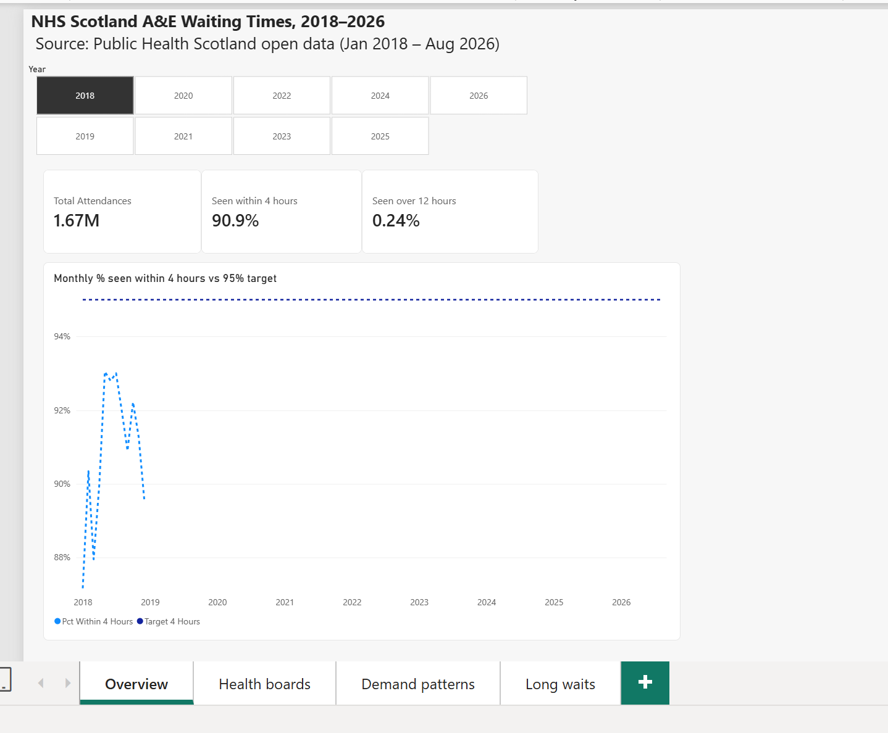
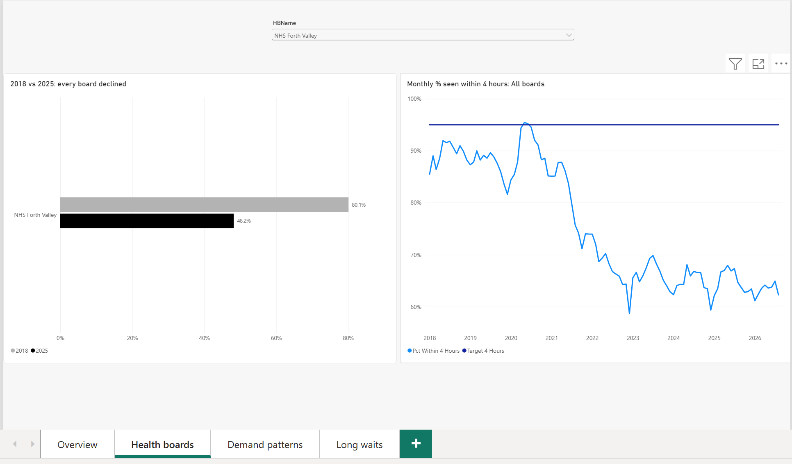
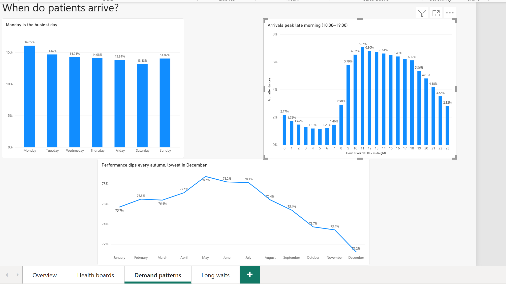
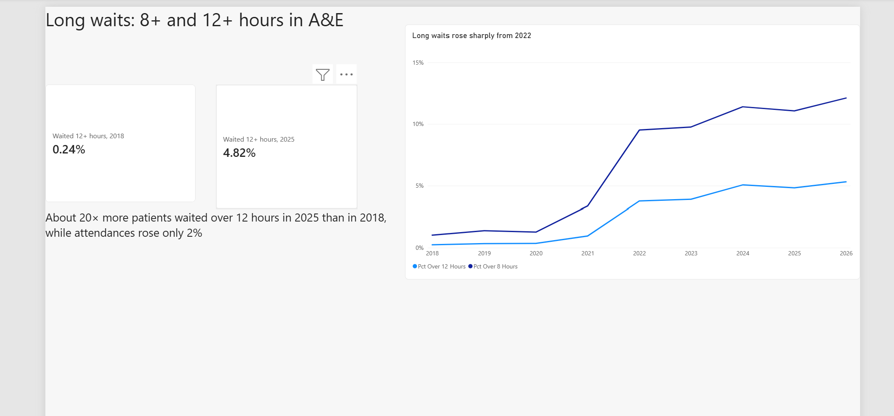

# nhs-scotland-ae-waiting-times
Analysis of A&amp;E waiting times across NHS Scotland (2018–2026) using Python, SQL and Power BI
# NHS Scotland A&E Waiting Times Analysis (2018–2026)

An end-to-end analysis of A&E performance across NHS Scotland using Public Health Scotland open data, built with **Python (pandas)**, **MySQL** and **Power BI**.

**Headline finding:** since 2018, A&E performance has fallen sharply and long waits have risen about 20-fold, but attendances have barely changed. The volume of patients arriving does not explain the decline.



---

## Key findings

| # | Question | Finding |
|---|----------|---------|
| 1 | How has 4-hour performance changed? | Fell from **90.9% (2018)** to **68.4% (2024)** and has stayed at about 68–70% since 2022. The 95% standard was not met in any year. |
| 2 | Which health boards perform best and worst? | **All 14 boards declined** (major EDs). **NHS Forth Valley** was lowest in both years (**80.1% → 48.2%**). The gap between the best and worst board grew from **18.4 to 45.3 points**. |
| 3 | Is there a winter pressure pattern? | Performance slides every autumn to a low in **December (71.2%)** and peaks in **May (78.7%)**. The worst months are **not** the busiest: August has the most attendances. |
| 4 | When do patients arrive? | **Monday is busiest** (16.0% of weekly attendances vs 13.1% on Saturday). Arrivals peak at **11:00–11:59 (7.1%)**, and **10:00–18:59 accounts for about 59%** of attendances. |
| 5 | Are long waits growing faster than attendances? | Between 2018 and 2025, attendances rose **2%**, but the share waiting **12+ hours rose from 0.24% to 4.82%** (3,737 → 77,880 patients). In 2025, about **1 in 21 patients** waited over 12 hours. |

**The common thread:** 2024 had *fewer* attendances than 2019, yet performance was 21 points worse, and the worst months of the year are not the busiest. The data suggests the problem lies in how quickly patients can leave A&E (for example, waiting for a hospital bed) rather than how many arrive. This dataset cannot prove the cause, so it is presented as a question the data raises.

---

## Dashboard

The Power BI report (`dashboard/nhs_ae_dashboard.pbix`) has four pages:

| Page | Contents |
|------|----------|
| **Overview** | KPI cards by year and the monthly 2018–2026 trend against the 95% target |
| **Health boards** | 2018 vs 2025 comparison for all 14 boards, plus a trend for any selected board |
| **Demand patterns** | Arrivals by day and hour, and performance by calendar month |
| **Long waits** | 8+ and 12+ hour waits over time |

| Health boards | Demand patterns | Long waits |
|---|---|---|
|  |  |  |

Power BI measures were validated against the SQL results (for example, yearly 4-hour performance matches to one decimal place).

---

## Data

Source: [Public Health Scotland open data](https://www.opendata.nhs.scot/), released under the UK Open Government Licence.

| File | Description |
|------|-------------|
| Monthly A&E Activity | Attendances and 4, 8 and 12-hour waits by month, health board and site |
| When | Attendances by day of week and hour of arrival |
| Health Board 2014–2019 | Lookup for health board names |
| Current NHS Hospitals in Scotland | Lookup for hospital names |

**Scope:** January 2018 to August 2026 (raw data from 2007 was available; 2018 onwards is the period with every breakdown).

---

## Approach

1. **Exploration** (`notebooks/01_data_exploration.ipynb`): checked shapes, data types, category values and missing data before changing anything.
2. **Cleaning** (`notebooks/02_data_cleaning.ipynb`): converted dates, filtered to 2018 onwards, removed duplicate attendance categories, dropped empty columns, joined board and hospital names, and added sort columns for days and hours. Every step is checked (row counts, missing values, recalculated percentages).
3. **Database** (`sql/01_create_tables.sql`, `notebooks/03_load_to_mysql.ipynb`): designed MySQL tables with data types and a primary key, then loaded and verified the row counts.
4. **Analysis** (`sql/02_business_questions.sql`): one query per business question, using CTEs, window functions (`SUM() OVER()`, `FIRST_VALUE()`) and conditional aggregation.
5. **Dashboard** (`dashboard/`): four-page Power BI report with DAX measures, slicers and controlled visual interactions.

---

## Data quality issues found and handled

| Issue | How it was found | Decision |
|-------|-----------------|----------|
| "All" attendance category duplicates "Unplanned" and "New planned" rows | Comparing rows in exploration | Kept "All" only, which matches the official 4-hour standard |
| Category spelled "New planned", not "New Planned" as documented | Listing unique values | Always filtered on the exact values in the data |
| An inner join silently dropped **301 rows (4%)** | Row-count check before and after the join | Switched to a left join with `validate="many_to_one"` |
| 9 small sites (0.32% of attendances) missing from the hospital lookup, mostly closed in 2019–2022 | Checking unmatched codes | Kept and labelled "Unlisted site (code)" so totals still match published figures |
| One record (NHS Western Isles, May 2025) shows 96 patients seen within 4 hours out of 69 attendances | Check for negative values | Kept the attendances; set its 4-hour fields to missing |

---

## Limitations

- 8 and 12-hour waits are only recorded for sites submitting episode-level data. Coverage was 94% of attendances in 2018 and 98% in 2025, so the trend is not caused by more sites reporting.
- The "When" file covers 58 sites and contains attendance counts only, so it shows demand, not waits by hour.
- Board comparisons use major emergency departments (Type 1). Island boards have much smaller departments, so they are not like-for-like with city hospitals.
- Spring 2020 attendances were unusually low because of COVID-19, which lifts the April–May averages slightly.
- 2026 covers January to August only and is excluded from seasonal comparisons.

---

## Possible recommendations

These follow from the patterns in the data and would need testing with operational information:

- **Look beyond the front door.** Since attendances barely changed while waits grew, investigate patient flow out of A&E (bed availability, discharge delays).
- **Match staffing to demand.** About 59% of patients arrive between 10:00 and 19:00, and Mondays are busiest.
- **Prepare for autumn.** Performance declines from September each year, so winter plans should start before December.
- **Focus support on the boards with the largest falls**, such as Forth Valley, Grampian and Lanarkshire.

---

## Repository structure

```
nhs-scotland-ae-waiting-times/
├── data/
│   ├── raw/               # Original PHS files (unchanged)
│   └── processed/         # Cleaned CSVs (not committed; created by notebook 02)
├── notebooks/
│   ├── 01_data_exploration.ipynb
│   ├── 02_data_cleaning.ipynb
│   └── 03_load_to_mysql.ipynb
├── sql/
│   ├── 01_create_tables.sql
│   └── 02_business_questions.sql
├── dashboard/
│   └── nhs_ae_dashboard.pbix
├── images/                # Dashboard screenshots
├── requirements.txt
└── README.md
```

---

## How to reproduce

1. Clone the repository and install the Python libraries:
   ```bash
   pip install -r requirements.txt
   ```
2. Run `notebooks/02_data_cleaning.ipynb` to create the cleaned files in `data/processed/`.
3. Run `sql/01_create_tables.sql` in MySQL, then `notebooks/03_load_to_mysql.ipynb` (it asks for your MySQL password; nothing is stored in the code).
4. Run the queries in `sql/02_business_questions.sql`.
5. Open `dashboard/nhs_ae_dashboard.pbix` in Power BI Desktop. If prompted, point the data source to your `data/processed/` folder.

---

## Author

**Ayush Kadam** · MSc Data Science for Business, University of Stirling
